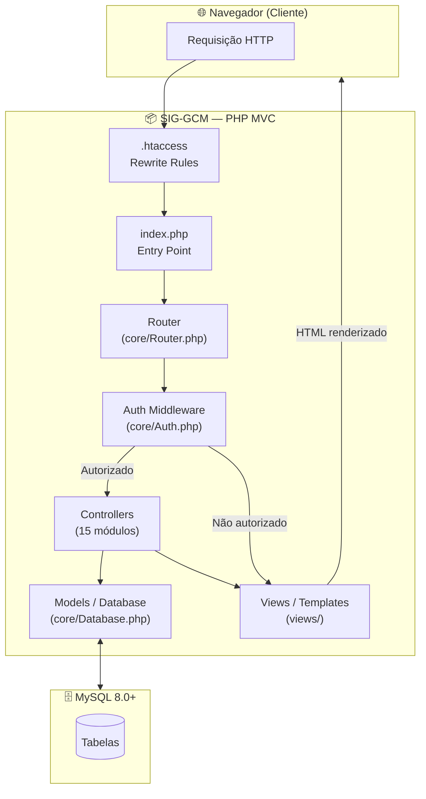
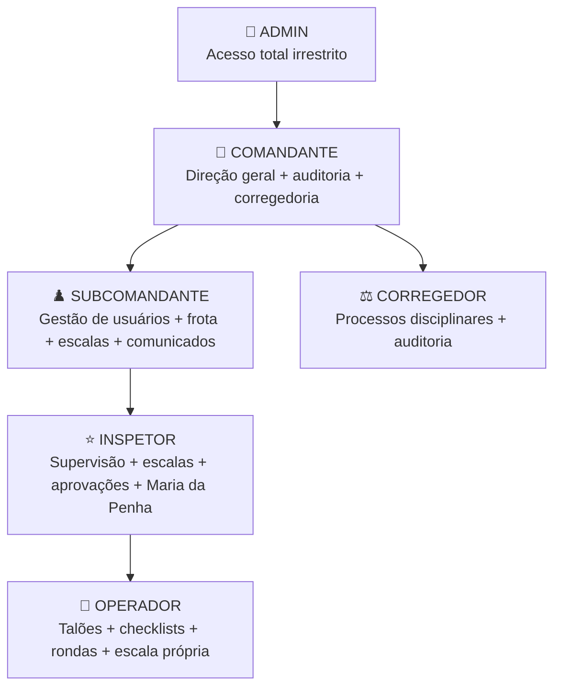

<div align="center">

# 🛡️ SIG-GCM
### Sistema Integrado de Gestão da Guarda Civil Municipal


> **Autora Original:** Rafaela Cristina Alcântara da Silva  
> [](https://github.com/rafaela13c)
> [](https://www.linkedin.com/in/rafaela-cas1308/)

</div>

---

> ⚠️ **PROJETO ACADÊMICO — Trabalho de Graduação / Conclusão de Curso (TG/TC)**
>
> Este sistema foi desenvolvido **100% por Rafaela Cristina Alcântara da Silva** como objeto de estudo acadêmico. NÃO é um sistema oficial da GCM, NÃO é utilizado em produção real por nenhum órgão público, e foi criado exclusivamente para fins de aprendizado, demonstração e avaliação acadêmica.

---

## 📌 O que é o SIG-GCM?

O **SIG-GCM (Sistema Integrado de Gestão da Guarda Civil Municipal)** é uma plataforma web completa para gestão operacional de uma corporação de Guarda Civil Municipal, desenvolvida em **PHP 8 (MVC Puro)** com banco de dados **MySQL**.

### Por que foi criado?

O sistema nasceu da necessidade identificada pela autora durante seu processo de formação acadêmica: **a maioria das GCMs brasileiras não possui um sistema de gestão integrado acessível para prefeituras de menor porte**. O SIG-GCM visa preencher essa lacuna como prova de conceito acadêmica.

### É gratuito? Posso usar?

**Sim.** O código-fonte é aberto e qualquer pessoa pode baixar, adaptar e usar este sistema, inclusive para a GCM da sua própria cidade, **desde que mantenha os créditos à autora original** e siga os termos da licença **CC BY-NC-SA 4.0**.

---

## 🌐 Ambiente de Demonstração (DEMO AO VIVO)

> 🔗 **Acesse o sistema de testes:** [https://lab-teste.site/](https://lab-teste.site/)

Use as credenciais abaixo para explorar todos os perfis de usuário sem instalar nada:

| Perfil | Usuário | Senha |
|---|---|---|
| 🔴 **Admin** | `admin` | `Admin@2025` |
| 🔵 **Operador** | `operador.teste` | `Teste@2025` |
| ⭐ **Inspetor** | `inspetor.teste` | `Teste@2025` |
| ♟️ **Subcomandante** | `subcmd.teste` | `Teste@2025` |
| 👑 **Comandante** | `comandante.teste` | `Teste@2025` |
| ⚖️ **Corregedor** | `corregedor.teste` | `Teste@2025` |

> ⚠️ O ambiente de testes é reiniciado automaticamente a cada acesso à tela de login. Tudo que você criar ali é fictício e será resetado.

---

## 🧩 Arquitetura do Sistema



---

## 👥 Hierarquia de Perfis e Permissões



---

## 🗂️ Módulos do Sistema

| # | Módulo | Descrição |
|---|---|---|
| 01 | 📊 **Dashboard** | KPIs operacionais por perfil, totalizadores e atalhos rápidos |
| 02 | 📋 **Talões de Ocorrência** | Registro e acompanhamento de ocorrências com mapa de calor |
| 03 | 🚗 **Frota** | Gestão de viaturas, checklists diários e abastecimentos |
| 04 | 📅 **Escalas** | Escalas 12×36 (operacional) e 5×2 (administrativo) com geração de PDF |
| 05 | 🔄 **Trocas de Plantão** | Solicitação e aprovação de trocas com fluxo de aprovação |
| 06 | 🏫 **Ronda Escolar** | Registro de visitas preventivas às escolas municipais |
| 07 | 🟣 **Maria da Penha** | Patrulha e acompanhamento de vítimas sob medida protetiva |
| 08 | ⚖️ **Corregedoria** | Processos disciplinares, sindicâncias e movimentações |
| 09 | 📢 **Comunicados** | Mural de avisos do comando com confirmação de leitura |
| 10 | 🌤️ **Clima** | Previsão do tempo integrada via API Windy/OpenWeather |
| 11 | 🔍 **Consultas Rápidas** | CEP, CNPJ, FIPE, feriados, validador CPF/CNH/Placa |
| 12 | 📈 **Relatórios** | Relatórios gerenciais avançados com gráficos e KPIs |
| 13 | 🕵️ **Auditoria** | Log completo de ações e histórico de logins |
| 14 | 👤 **Usuários** | Gestão de contas, permissões granulares e perfis |
| 🤖 | **Modo Ajuda (IA)** | Assistente virtual Gemini 2.5 Flash para dúvidas do sistema |

---

## ⚙️ Instalação

### Pré-requisitos

- PHP 8.0 ou superior
- MySQL 8.0 ou superior
- Apache com `mod_rewrite` ativo (ou equivalente Nginx)
- Extensões PHP: `pdo_mysql`, `mbstring`, `json`

### Passo a Passo

#### 1. Clone o repositório

```bash
git clone https://github.com/rafaela13c/sig-gcm.git
cd sig-gcm
```

#### 2. Configure o Banco de Dados

Copie o arquivo de exemplo e preencha com suas credenciais:

```bash
cp config/database.php.example config/database.php
```

Edite `config/database.php`:

```php
define('DB_HOST', 'localhost');
define('DB_NAME', 'sig_gcm');       // Nome do seu banco
define('DB_USER', 'seu_usuario');   // Usuário do MySQL
define('DB_PASS', 'sua_senha');     // Senha do MySQL
```

#### 3. Crie o banco de dados

```sql
CREATE DATABASE sig_gcm CHARACTER SET utf8mb4 COLLATE utf8mb4_unicode_ci;
```

#### 4. Instale as tabelas e dados iniciais

Acesse o sistema no navegador. A **instalação é automática**: assim que a página de login carregar, o sistema detecta a ausência de tabelas e as cria automaticamente, incluindo os usuários de demonstração.

Ou pode executar manualmente:
```
http://seu-servidor/migrations/setup.php
```

#### 5. Primeiro acesso

- **URL:** `http://seu-servidor/`
- **Usuário:** `admin`
- **Senha:** `Admin@2025`

> 🔐 Altere a senha do admin imediatamente após o primeiro acesso em produção!

#### 6. (Opcional) Assistente de IA

Se quiser usar o Modo Ajuda com IA Gemini:

1. Obtenha uma API Key gratuita em [aistudio.google.com](https://aistudio.google.com)
2. Edite `assets/js/ai-assistant.js` e substitua `YOUR_GEMINI_API_KEY_HERE` pela sua chave

---

## 📁 Estrutura de Pastas

```
SIG-GCM/
├── .htaccess                  # URL Rewrite rules (Apache)
├── index.php                  # Entry point — roteamento central
├── config/
│   ├── app.php                # Configurações gerais, constantes, timezone
│   └── database.php.example   # Template de configuração do banco (COPIE para database.php)
├── core/
│   ├── Auth.php               # Sistema de autenticação, permissões e CSRF
│   ├── Controller.php         # Classe base para controllers
│   ├── Database.php           # PDO wrapper, auto-install e seeding de dados
│   ├── Router.php             # Roteador HTTP
│   └── AuditLogger.php        # Logger de auditoria
├── controllers/               # 15 controllers (um por módulo)
├── models/                    # Models de dados
├── views/                     # Templates PHP/HTML por módulo (17 pastas)
│   └── layouts/
│       └── main.php           # Layout principal do sistema
├── assets/
│   ├── css/style.css          # Design System principal
│   ├── js/ai-assistant.js     # Módulo de IA (Gemini)
│   └── data/sig_gcm_knowledge.json  # Base de conhecimento do assistente IA
├── migrations/
│   └── setup.php              # Script de instalação manual
└── uploads/                   # Fotos e arquivos (não versionado)
```

---

## 🔐 Segurança

| Recurso | Implementação |
|---|---|
| Hash de senha | bcrypt (custo 12) via `password_hash()` |
| CSRF | Token gerado por `random_bytes(32)` em todos os formulários |
| Bloqueio de login | 3 tentativas → bloqueio de 15 minutos |
| Timeout de sessão | 8 horas (configurável em `config/app.php`) |
| Auditoria | Log completo de ações (INSERT/UPDATE/DELETE) e todos os logins |
| Controle de acesso | Sistema granular de permissões por usuário/recurso |
| Headers | HTTP security headers via `.htaccess` |

---

## 📜 Licença e Autoria

```
SIG-GCM © 2025–2026 Rafaela Cristina Alcântara da Silva
Licenciado sob Creative Commons CC BY-NC-SA 4.0

Você pode:
  ✅ Usar, copiar, adaptar e distribuir este sistema gratuitamente
  ✅ Usar em GCMs municipais sem fins comerciais

Você DEVE:
  📌 Dar crédito à autora original (Rafaela Cristina Alcântara da Silva)
  📌 Manter esta licença em trabalhos derivados

Você NÃO pode:
  ❌ Usar comercialmente sem autorização expressa da autora
  ❌ Reivindicar a autoria original do código como sendo sua
```

> **Declaração de originalidade:** Este código-fonte foi escrito integralmente pela autora, do zero, em PHP 8 com arquitetura MVC. Qualquer alegação de plágio é factualmente inverídica e não se sustenta, dada a completa diferença de tecnologia, arquitetura e estrutura em relação a qualquer outro sistema.

Veja o arquivo [LICENSE](./LICENSE) para o texto completo da licença.

---

## 🤝 Contribuições

Contribuições são bem-vindas! Veja [CONTRIBUTING.md](./CONTRIBUTING.md) para as diretrizes.

## 🔒 Segurança

Para reportar vulnerabilidades de segurança ou violações de licença, veja [SECURITY.md](./SECURITY.md).

---

<div align="center">

**Desenvolvido com 💙 por [Rafaela Cristina Alcântara da Silva](https://github.com/rafaela13c)**

*Projeto Acadêmico — Trabalho de Conclusão de Curso*

</div>
